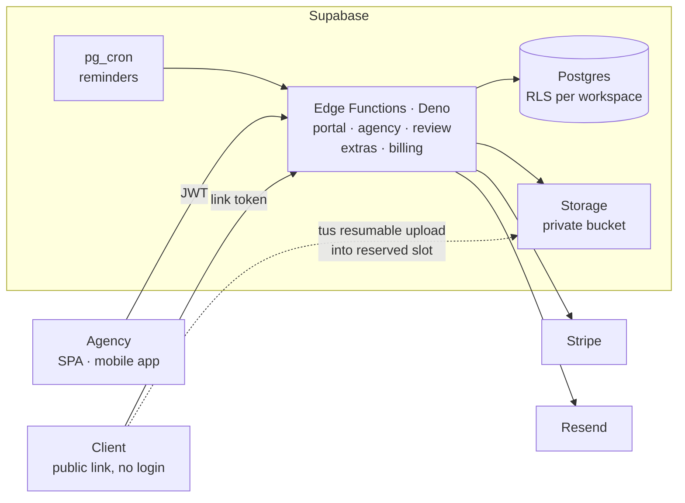

# ClientDrop

**A client portal for agencies and freelancers. One link collects everything a client owes you (files, texts, passwords, videos, approvals and payments) without the client creating an account.**

🌐 Live: [clientdrop.centtra.com.br](https://clientdrop.centtra.com.br) · 🌎 Portuguese, English and Spanish · 📱 Web and mobile app

> **About this repository.** ClientDrop is a commercial product, so its source code is private.
> This repository is a public showcase: it explains what the product does and how it is built, and it
> includes real files from the codebase so you can judge the code itself.
> Access to the private repository can be granted during a hiring process. Just ask.

---

## The problem

Agencies lose days chasing clients for logos, copy, access passwords and approvals across email and WhatsApp. ClientDrop
turns that into a checklist behind a single link. The client opens it on the phone, fills in what is missing and is
done, and the agency sees what came in and what is still pending.

## What it does

| Area | Highlights |
|---|---|
| **Requests** | A checklist per client (files, text, passwords, videos), a public link with no login, reminders, and the request closes itself when every required item is in |
| **Secrets** | Passwords are encrypted on the server, and revealing one is an explicit, logged action by the agency |
| **Approvals** | The client approves creative pieces, asks for changes, comments on a point of an image or a second of a video, and sees the previous version |
| **Large uploads** | Videos up to 2 GB straight from the phone, in 6 MB chunks with resume (tus protocol) |
| **Scope & billing** | Change requests the client approves by link, invoices with e-mail reminders (D-3 to D+14) or a WhatsApp shortcut |
| **Plans** | Free plan with limits enforced in the database, paid plans through Stripe (monthly card subscription or 31-day Pix pass) |

## Architecture

### Key engineering decisions

- **The link is the credential, so it is treated like one.** Public functions accept a random token of fixed format,
  return the same "not found" for anything invalid, scope every query to that one request and rate-limit writes per link.
- **Encryption with key versioning.** Secrets are sealed with AES-256-GCM, with the item id as additional
  authenticated data, so a ciphertext can't be moved to another item. A version prefix allows key rotation without
  breaking older data.
- **Limits live in the database.** Plan limits and storage quotas are enforced by Postgres (RLS and constraints), not
  only by the UI, and the agency can't forge a client's approval.
- **Small and fast on purpose.** The agency app is a dependency-free vanilla JS single-page app. Business logic runs in
  Supabase Edge Functions, so there is no separate server to maintain.

## Stack

**Frontend:** Vanilla JavaScript SPA (hash routing), i18n (pt / en / es), Capacitor (Android / iOS)
**Backend:** Supabase Edge Functions (Deno, TypeScript), Postgres with RLS, Storage, pg_cron
**Integrations:** Stripe (Checkout, subscriptions, webhooks), Resend, tus resumable uploads
**Infra:** Vercel (static hosting), Supabase, GitHub Actions

## Code samples in this repository

| File | What it shows |
|---|---|
| [`samples/supabase/functions/portal/index.ts`](samples/supabase/functions/portal/index.ts) | The public client-portal endpoint: token validation, per-link rate limiting, request scoping, event log |
| [`samples/supabase/functions/_shared/crypto.ts`](samples/supabase/functions/_shared/crypto.ts) | AES-256-GCM sealing with AAD and versioned keys (Web Crypto API) |
| [`samples/app/tus.js`](samples/app/tus.js) | A dependency-free resumable upload client for large videos |

## Author

**Leandro Rocha** · civil engineer and software developer · Brazil
I design, build and operate the Centtra products end to end, from database and architecture to UI.

---

### 🇧🇷 Resumo em português

O **ClientDrop** é um portal para agências e freelancers coletarem dos clientes arquivos, textos, senhas, vídeos,
aprovações e pagamentos por um único link, sem o cliente criar conta. O código é privado por ser um produto comercial.
Este repositório mostra a arquitetura, as decisões técnicas e arquivos reais. O acesso ao repositório privado pode ser
liberado durante um processo seletivo.
